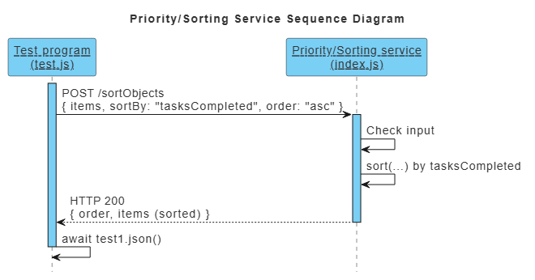

# Priority/Sorting Microservice

## Authors
Bailey, Corson, Lucas

## Requirements
    Node.js v18+

## Setup

Install dependencies
```
     npm install
```
Run server
```
    node index.js
```

Run test script
```
    node test.js
```

## Description
This microservice takes either a list of Objects, or a simple list, and outputs a sorted version.
There are three ways to use this service:

## 1. Sorting by field.
With the route /sortObjects, if you send a request it should include the following fields:
items: A list of objects you are wanting to sort.
sortBy: The field in the list of items you want to sort by.
order: 'asc' or 'desc'. This will return the sort in ascending or descending order.

The response will be a JSON object with the order field, and then the items list in sorted order.

## 2. Sorting by priority.
If your program prioritizes items with a value outside of the item object itself, you should use the /priority route.
The request should include the following fields:
priorityItems: An array, each array item should have an "item" field which is the object to sort, and a "priority" field, which is a numerical value indicating the item's priority.
order: 'asc' or 'desc'. This will return the sort in ascending or descending order.

## 3. List sort
This route takes a list and sorts it ascending or descending. The list items must be of the same type. This is through the /sort route.
The request should include the following fields:
items: A list containing only values.
order: 'asc' or 'desc'. This will return the sort in ascending or descending order.


## Example request
```
await fetch(`http://localhost:${PORT}/sortObjects`, {
            method: 'POST',
            headers: { 'Content-Type': 'application/json' },
            body: JSON.stringify({
                items: teammates,
                sortBy: 'tasksCompleted',
                order: 'asc'
            })
        });
```

## Example receive
```
example_sort = await fetch(`http://localhost:${PORT}/priority`, {
            method: 'POST',
            headers: { 'Content-Type': 'application/json' },
            body: JSON.stringify({
                priorityItems: pets,
                order: 'asc'
            })
        });

console.log("Sorted items:")
console.log(await example_sort.json())
```
## UML Diagram


